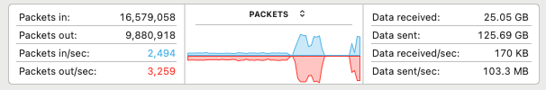

## {background-image="bg/wb4.png"}

::: {style="text-align: center;"}

{width="20%"} {width="20%"} {width="20%"} {width="20%"}
:::

::: {style="text-align: center;"}

{width="50%"}

:::

::: {style="text-align: center;"}

{width="70%"}

:::

## Also Me {background-image="bg/wb4.png"}


## How this all came about {background-image="bg/wb4.png"}


https://dewey.dunnington.ca/post/2024/wrangling-and-joining-130m-points-with-duckdb--the-open-source-spatial-stack/

## geopandas

```python
import geopandas as gpd

gpd.read_file(...).to_postgis()
```

## ogr2ogr

```shell
ogr2ogr
```

## duckdb

```sql
ATTACH

CREATE TABLE ... as SELECT * FROM "foofy.parquet"
```

## ADBC

In Python:

```python
import adbc_driver_postgresql

conn = adbc_driver_postgresql.dbapi.connect(...)
with conn.cursor() as cur:
    ...
```


## ADBC

Also works in R:

```r
library(adbcdrivermanager)


```

## The moment you've all been waiting for...

## geopandas

## Two basic approaches

Insert + bind (geopandas, ogr2ogr without PG_USECOPY=1):

```sql
INSERT INTO dst VALUES (...);
INSERT INTO dst VALUES (...);
INSERT INTO dst VALUES (...);
INSERT INTO dst VALUES (...);
...
```


## Two basic approaches

COPY (DuckDB, ogr2ogr with PG_USECOPY=1, ADBC):

```sql
COPY () FORMAT BINARY;
```



## Parquet + Arrow make it possible

- Stream anything from source to destination, low dependency
- Enables anything exportable as Arrow to go through the DuckDB path
- Enables the result of any DuckDB query to go through the ADBC path
- Parquet storage is fast + flexible + small
- Enables DuckDB and SedonaDB to leverage GDAL's readers

## Parquet + Arrow make it possible

But some holes to fill in the ecosystem:

- ADBC's Postgres driver needs native PostGIS support for the fast COPY path
- All of the non-GDAL tools have a questionable CRS propagation game

## {background="#26374a"}

::: {style="text-align: center;"}


[apache/arrow-adbc](https://github.com/apache/arrow-adbc) / [arrow.apache.org/adbc](https://sedona.apache.org/sedonadb)

:::
