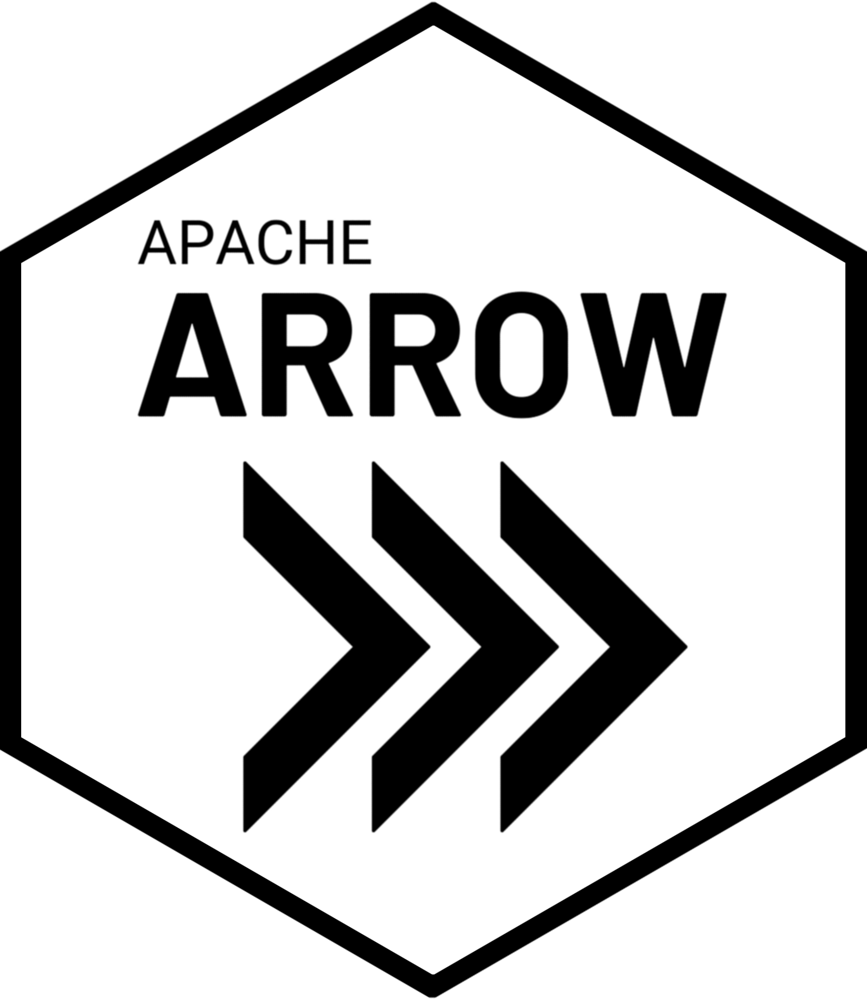

## {background-image="bg/wb4.png"}

::: {style="text-align: center;"}

{width="20%"} {width="20%"} {width="20%"} {width="20%"}
:::

::: {style="text-align: center;"}

{width="50%"}

:::

::: {style="text-align: center;"}

{width="70%"}

:::

## Also Me {background-image="bg/wb4.png"}

## {background="#26374a"}

::: {style="text-align: center;"}

[apache/sedona-db](https://github.com/apache/sedona-db) / [sedona.apache.org/sedonadb](https://sedona.apache.org/sedonadb)

:::

