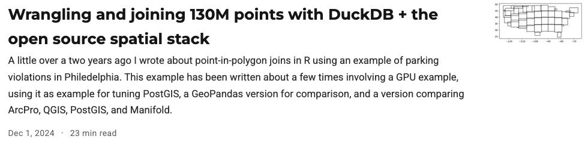
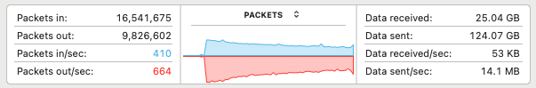

```{r,setup}
#| include: false
library(tidyverse)
```

## {background-image="bg/wb4.png"}

::: {style="text-align: center;"}

{width="20%"} {width="20%"} {width="20%"} {width="20%"}
:::

::: {style="text-align: center;"}

{width="50%"}

:::

::: {style="text-align: center;"}

{width="70%"}

:::

## Also Me {background-image="bg/wb4.png"}


## How this all came about {background-image="bg/wb3.png"}



https://dewey.dunnington.ca/post/2024/wrangling-and-joining-130m-points-with-duckdb--the-open-source-spatial-stack/

## How this all came about {background-image="bg/wb3.png"}

- PostGIS is a great way to use all of your (or your server's) cores to execute a lot of tiny window queries or a spatial join
- ...but you have to get the data into PostGIS

## geopandas {background-image="bg/wb3.png"}

```python
import geopandas as gpd
import pyarrow.parquet as pq
from geoalchemy2 import Geometry

table = pq.read_table("fixture.parquet")
gdf = table.to_pandas()
gdf["geometry"] = gpd.GeoSeries.from_wkb(gdf["geometry"])
gdf = gpd.GeoDataFrame(gdf, geometry="geometry")

gdf.to_postgis(
    "destination", engine, if_exists="replace", index=False,
    dtype={"geometry": Geometry(spatial_index=False)},
)
```

Good: intuitive!
Tricky: materialize the entire table up front, slowest method

## ogr2ogr {background-image="bg/wb3.png"}

```shell
ogr2ogr --config PG_USE_COPY YES \
  -f PostgreSQL -overwrite -nln destination \
  -lco GEOMETRY_NAME=geom -lco SPATIAL_INDEX=NONE \
  "PG:host=... dbname=... user=..." \
  fixture.parquet fixture
```

Good: one liner, flexible input
Tricky: must remember to ingest without spatial index and with copy, need to find a build with Arrow for Parquet

## duckdb {background-image="bg/wb3.png"}

```sql
INSTALL postgres; LOAD postgres;
INSTALL spatial;  LOAD spatial;

CREATE SECRET postgis_ingest (TYPE postgres, ...);
ATTACH '' AS postgis (TYPE postgres, SECRET postgis_ingest);

DROP TABLE IF EXISTS postgis.destination;
CREATE TABLE postgis.destination AS
  SELECT * FROM read_parquet('fixture.parquet');
```

Good: great if you're in the DuckDB ecosystem! Fastest over the network.
Tricky: No Z value support

## ADBC (Python: adbc-alter)  {background-image="bg/wb3.png"}

```python
import adbc_driver_postgresql.dbapi as dbapi
import pyarrow as pa
import pyarrow.parquet as pq

parquet = pq.ParquetFile("fixture.parquet")
reader = pa.RecordBatchReader.from_batches(
    parquet.schema_arrow, parquet.iter_batches()
)

with dbapi.connect(uri) as conn, conn.cursor() as cur:
    cur.adbc_ingest("destination", reader, mode="replace")
    cur.execute("""
        ALTER TABLE destination ALTER COLUMN geometry TYPE geometry
        USING ST_GeomFromWKB(geometry)
    """)
```

Good: Flexible and low dependency (any Arrow stream in!)
Tricky: Requires an ALTER TABLE without a workaround

## The moment you've all been waiting for... {background-image="bg/wb3.png"}

## The results  {background-image="bg/wb4.png"}

ns-water elevation (11 million points), ns-water water_poly (700k polygons)

```{r}
#| echo: false

results <- list.files(pattern = "\\.csv$", full.names = TRUE) |>
  purrr::map_dfr(readr::read_csv, show_col_types = FALSE) |>
  dplyr::filter(status == "ok") |>
  dplyr::mutate(
    method = factor(
      method,
      levels = c("geopandas", "ogr2ogr", "duckdb", "duckdb-copy", "adbc-alter", "adbc-direct") |>
        rev()
    )
  )

results |>
  filter(dataset != "microsoft-buildings_point") |>
  ggplot(aes(x = elapsed_seconds, y = method, colour = name)) +
  geom_jitter(height = 0.15, width = 0, alpha = 0.8, size = 2) +
  facet_wrap(~dataset, ncol = 2) +
  scale_x_continuous(limits = c(0, NA)) +
  labs(x = "Time (seconds)", y = NULL, colour = NULL) +
  theme_minimal(base_size = 18) +
  theme(legend.position = "bottom")
```

## The results  {background-image="bg/wb4.png"}

ns-water elevation (11 million points), ns-water water_poly (700k polygons)

```{r}
#| echo: false

results |>
  filter(dataset != "microsoft-buildings_point", method != "geopandas") |>
  ggplot(aes(x = elapsed_seconds, y = method, colour = name)) +
  geom_jitter(height = 0.15, width = 0, alpha = 0.8, size = 2) +
  facet_wrap(~dataset, ncol = 2) +
  scale_x_continuous(limits = c(0, NA)) +
  labs(x = "Time (seconds)", y = NULL, colour = NULL) +
  theme_minimal(base_size = 18) +
  theme(legend.position = "bottom")
```

## The results  {background-image="bg/wb3.png"}

- GeoPandas bottleneck is per-row cost (slower for points vs. polygons, even if the total geometry size is similar)
- On localhost, ogr2ogr bottleneck is how fast it can read the source (FlatGeoBuf is not quite fast enough to saturate the loopback). On gigabit+ connectivity this matters less.
- After we support COPY for geometry natively, ADBC and DuckDB are the fastest and most consistent ways to get geometry into PostGIS.

## The results  {background-image="bg/wb3.png"}

microsoft-buildings_point (130 million points)

```{r}
#| echo: false

results |>
  filter(dataset == "microsoft-buildings_point") |>
  ggplot(aes(x = elapsed_seconds, y = method, colour = name)) +
  geom_jitter(height = 0.15, width = 0, alpha = 0.8, size = 2) +
  facet_wrap(~dataset, ncol = 2) +
  scale_x_continuous(limits = c(0, NA)) +
  labs(x = "Time (seconds)", y = NULL, colour = NULL) +
  theme_minimal(base_size = 18) +
  theme(legend.position = "bottom")
```

## The results  {background-image="bg/wb3.png"}

microsoft-buildings_point (130 million points)

```{r}
#| echo: false

results |>
  filter(dataset == "microsoft-buildings_point", method != "geopandas") |>
  ggplot(aes(x = elapsed_seconds, y = method, colour = name)) +
  geom_jitter(height = 0.15, width = 0, alpha = 0.8, size = 2) +
  facet_wrap(~dataset, ncol = 2) +
  scale_x_continuous(limits = c(0, NA)) +
  labs(x = "Time (seconds)", y = NULL, colour = NULL) +
  theme_minimal(base_size = 18) +
  theme(legend.position = "bottom")
```

## The results  {background-image="bg/wb3.png"}

- GeoPandas requires materializing the input, which here requires ~50GB memory
- ogr2ogr is suprisingly slow here (surprising because it uses a similar approach to ADBC and DuckDB)
- Multiple connections may be helpful in maximizing throughoput at this scale (duckdb-copy is doing this explicitly)
- After we support COPY for geometry natively, ADBC and DuckDB are the fastest and most consistent ways to get geometry into PostGIS.

## Two basic approaches: INSERT  {background-image="bg/wb3.png"}

Insert + bind (geopandas, ogr2ogr without PG_USECOPY=1):

```sql
INSERT INTO dst VALUES (...);
INSERT INTO dst VALUES (...);
INSERT INTO dst VALUES (...);
INSERT INTO dst VALUES (...);
...
```



## Two basic approaches: COPY  {background-image="bg/wb3.png"}

COPY (DuckDB, ogr2ogr with PG_USECOPY=1, ADBC):

```sql
COPY () FORMAT BINARY;
```


## 2.5 basic approaches: Multiplexed COPY  {background-image="bg/wb3.png"}

COPY (DuckDB, DuckDB-copy):

```sql
COPY () FORMAT BINARY;
COPY () FORMAT BINARY;
COPY () FORMAT BINARY;
COPY () FORMAT BINARY;
COPY () FORMAT BINARY;
COPY () FORMAT BINARY;
```


## Parquet + Arrow make it possible  {background-image="bg/wb3.png"}

- Stream anything from source to destination, low dependency
- Enables anything exportable as Arrow to go through the DuckDB path
- Enables the result of any DuckDB query to go through the ADBC path
- Parquet storage is fast + flexible + small
- Enables DuckDB and SedonaDB to leverage GDAL's readers

## Parquet + Arrow make it possible   {background-image="bg/wb3.png"}

But some holes to fill in the ecosystem:

- ADBC's Postgres driver needs native PostGIS support for the fast COPY path
- All of the non-GDAL tools have a questionable CRS propagation game
- DuckDB has trouble with Z values

## {background="#26374a"}

::: {style="text-align: center;"}


[apache/arrow-adbc](https://github.com/apache/arrow-adbc) / [arrow.apache.org/adbc](https://sedona.apache.org/sedonadb)

:::
